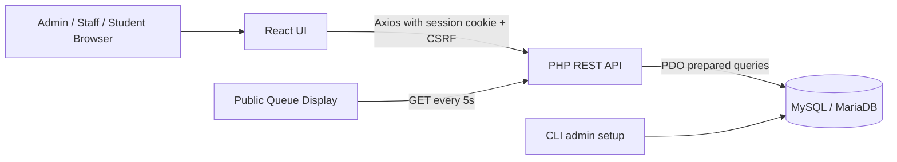
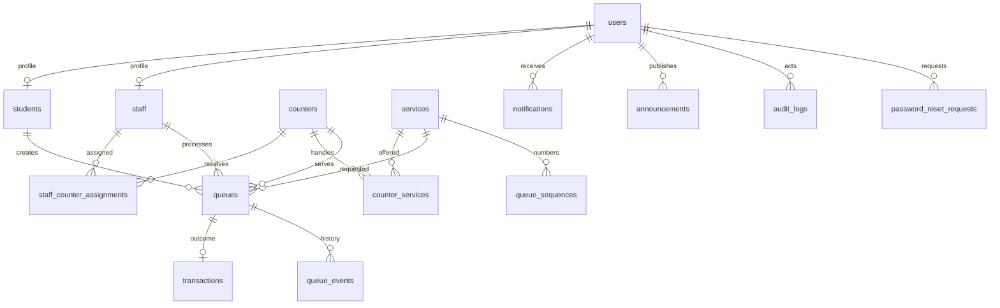
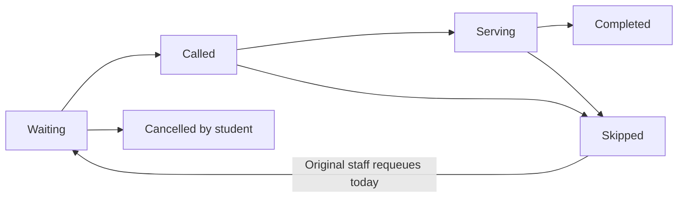

# System Architecture and Data Flow

## Overview

- **React (Vite/Tailwind)**: browser UI, local in development on `:5173`, role-restricted React routes.
- **PHP HTTP API (Apache/XAMPP)**: server-side authentication, authorization, validation, workflows, audit records and reporting.
- **MariaDB/MySQL**: authoritative data source. SQL uses InnoDB transactions, unique keys, and foreign keys.
- **Polling**: authorized dashboards periodically GET queue endpoints; the public display receives ticket/counter data without student identities.

## Entity Relationship Diagram

## Role rules

- **Admin**: management, reports, audit logs, staff/student password resets, priority levels, and configuration. CLI required for initial admin account.
- **Staff**: may only call next tickets from assigned counter and process tickets assigned to their own staff ID/counter; may requeue skipped tickets they previously handled on the same day.
- **Student**: may only create tickets for own account, see own active tickets/history, cancel own waiting tickets, and see own notifications.
- **Public**: active services, published announcements, anonymized queue display, auth forms.

## Queue lifecycle

Ticket generation locks the `students` row to serialize requests from one student, then increments an InnoDB `queue_sequences` row atomically inside a transaction. The unique key `(queue_date, service_id, queue_sequence)` rejects duplicate numbers even if an application bug is introduced. Active ticket checks prevent multiple simultaneously active tickets for a student.

Calling the next ticket locks the physical counter, verifies the counter is not serving another ticket, and locks a waiting eligible queue row with `SELECT ... FOR UPDATE`. This prevents ordinary double-call races on separate staff counters. Priority is sorted before time of arrival. If staff changes assignment, administrators are blocked from reassigning a staff member or occupied counter while an active ticket is in progress.

`queues` is the authoritative current status; `transactions` stores closed staff service outcomes; `queue_events` maintains a status-transition audit trail. Full-system audit records are written to `audit_logs`.

## Deployment and security assumptions

- The frontend **does not store credentials or tokens in localStorage**. The PHP session is an HttpOnly cookie, with JavaScript-readable CSRF tokens held only in memory.
- Vite's `/api` reverse proxy preserves same-origin credentials locally.
- CSRF token is required for POST, PUT, PATCH, and DELETE.
- PHP password hashes are generated using `password_hash(PASSWORD_DEFAULT)`.
- PDO emulated prepares are disabled.
- Session ID is regenerated upon login.
- `backend/.env` is not version-controlled and must be excluded from web access outside the `backend/public` document root in real deployments. XAMPP's project-under-htdocs layout is only for **local development**; access to `.env`, scripts and SQL files should be denied explicitly if publishing publicly.
- Apache `.htaccess` must be honored to route requests.

## Deliberate simplifications

This capstone-ready code prioritizes a runnable local project. It does not provide email/SMS gateways, student directory SSO, QR scanning, payment handling, official document generation, automatic archival jobs, enterprise monitoring, or formal WCAG audit. Add those as separate integrations rather than assuming they exist.
